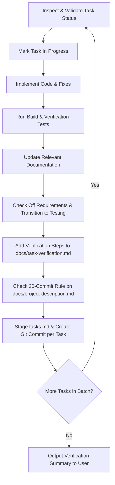

# Execute Tasks Workflow Skill

This skill defines the standardized procedure for executing a specific set of tasks sequentially with strict status validation, documentation updates, follow-up tracking, inclusion of `tasks.md` changes, per-task commits, and comprehensive verification instructions.

---

## 1. Task Status Validation & Confirmation

Before starting execution on any given task ID, inspect its status using `./scripts/get-task <ID>`:

- **Valid Statuses to Work On**:
  - `ready` / `pending` (Ready for implementation)
  - `in_progress` (Work currently active)

- **Invalid / Ambiguous Statuses**:
  - `planning`: Scoping incomplete; requirements still unknown.
  - `triage`: Requirements known, but prioritization or technical approach unconfirmed.
  - `research`: Technical investigation required before planning.
  - `testing`: Feature is already implemented and currently awaiting human verification.
  - `done` / `fixed`: Task is already completed and verified.
  - `cancelled`: Task was discarded or rejected.
  - `blocked`: Task is waiting on external dependencies or decisions.

> [!WARNING]
> **Status Check Rule**: If any requested task is in an invalid status (such as `planning`, `triage`, `research`, `testing`, `done`, `cancelled`, or `blocked`), you **must stop, report the task ID and its current status to the user, explain why it is not ready for implementation, and ask for explicit confirmation** before proceeding with that task.

---

## 2. Step-by-Step Task Execution Loop

Process each validated task **strictly one at a time** in the requested order:



### Step A: Mark In Progress
Transition the task to active work:
```bash
./scripts/update-task <ID> --status in_progress
```

### Step B: Implement Requirements
1. Read the task requirements using `./scripts/get-task <ID>`.
2. Inspect the relevant source files and implement the requested changes adhering to project architecture and best practices.
3. If partial implementation is required or edge cases emerge, record notes directly in the task description.

### Step C: Verify & Test
Run build verification and automated tests to ensure no regressions:
```bash
npm test -w @oldbear/client
npm test -w @oldbear/shared
```

### Step D: Update Documentation
Check if the changes affect:
- [README.md](file:///Users/tom/Projects/OldBearBattles/README.md)
- `docs/` specifications or architecture guides
Update the corresponding documentation files accordingly.

### Step E: Transition Task to Testing (Not Done)
Check off completed checklist items and transition status to `testing`:
```bash
./scripts/update-task <ID> --status testing --check-all
```
If specific items need implementation notes:
```bash
./scripts/update-task <ID> --status testing --append-description "### Implementation Notes:\n- Completed core logic."
```
> [!IMPORTANT]
> **Testing vs Done**: The agent sets the status to `testing`. The user will manually test the feature and create their own commit transitioning the status to `done` once verified.

### Step F: Record Newly Discovered Tasks
If during the work any new bugs, edge cases, refactor opportunities, or follow-ups are discovered, log them immediately in `planning` status:
```bash
./scripts/add-task "Follow-up: <Descriptive Title>" --project=<proj> --type=<type> --status=planning -d "Discovered during work on <ID>:\n- [ ] Detail"
```

### Step G: Update `docs/task-verification.md`
Add clear, step-by-step verification instructions for the completed task into [docs/task-verification.md](file:///Users/tom/Projects/OldBearBattles/docs/task-verification.md) under the appropriate section:
- Include task ID, title, where to find it in the UI, exact steps to execute, and pass/fail criteria.
- *(Note: Once a human tester verifies a feature and marks it `done`, the verification steps are migrated from `docs/task-verification.md` into `docs/human-tests.md` as permanent regression tests).*

### Step H: Check 20-Commit Rule on Project Description
Check the number of commits since `docs/project-description.md` was last modified:
```bash
LAST_COMMIT=$(git log -n 1 --pretty=format:"%H" -- docs/project-description.md)
git rev-list --count ${LAST_COMMIT}..HEAD
```
If the count is $\ge 20$ (or if major features/technologies were added):
1. Update `docs/project-description.md` with current UTC timestamp (`- Last Verified UTC: YYYY-MM-DDTHH:MM:SSZ`) and any major feature changes.
2. Update `docs/project-description.json` with `"lastVerifiedUtc": "YYYY-MM-DDTHH:MM:SSZ"`.
3. Include these files in the commit (resetting the 20-commit counter).

### Step I: Include tasks.md & Create Git Commit
When creating the commit for the task:
1. **Always include `docs/tasks.md` and `docs/task-verification.md`**: Check `git status`. Ensure all changes to `docs/tasks.md` (including user edits or pre-staged edits) and `docs/task-verification.md` are staged:
```bash
git add docs/tasks.md docs/task-verification.md <other-modified-files>
git commit -m "<type>(<project>): <concise summary of task ID>"
```
*(At least one commit must be made per completed task before moving to the next task).*

### Step J: Verification Instructions in Response
Always provide clear verification instructions so the user can easily test the work:
1. **Single Task / Small Batch**: Include clear, actionable step-by-step verification instructions directly in your response to the user.
2. **Batch / Many Tasks**: If executing a batch of multiple tasks, create a dedicated verification report in `docs/` (e.g. `docs/verification-report.md`) detailing the changes, commits, and verification steps for each task, and link to it in your final response.
